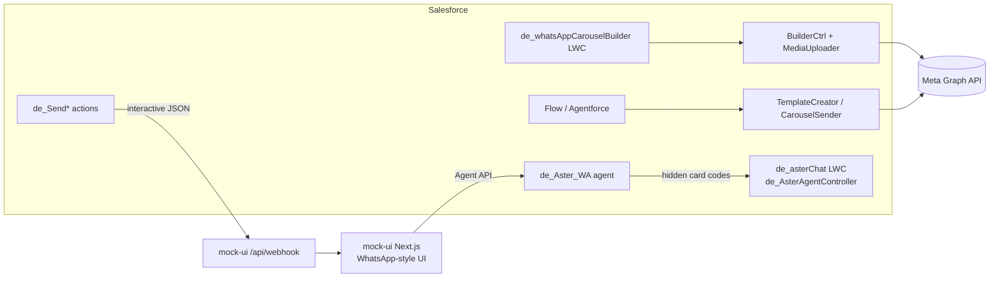

# carousel-craft

Build, submit and send **WhatsApp carousel templates** from Salesforce, and demo rich WhatsApp commerce messages driven by an Agentforce agent. The demo brand is the fictional **Aster & Oak**.

## What it does

**1. Carousel template builder (Lightning)**

- The `de_whatsAppCarouselBuilder` LWC (tab: *WhatsApp Carousel Builder*) lets you compose a carousel template: header, body, footer and cards. Each card has an image or video from Salesforce Files plus quick-reply, URL or phone buttons.
- `de_WhatsAppMediaUploader` uploads the card media to Meta's resumable upload API. `de_WhatsAppCarouselBuilderCtrl` submits the template to the Meta Graph API for approval.
- Invocable actions (`de_WhatsAppCarouselTemplateCreator`, `de_WhatsAppCarouselSender`) expose template creation and sending to Flow and Agentforce. `de_Send_WhatsApp_Carousel_Test` is a sample flow.

**2. Rich-message demo for an Agentforce WhatsApp agent**

The `de_Aster_WA` agent runs a scripted shopping journey: product carousel, product detail, skin-type question and recommendation, buy with saved-address confirmation, payment link, order tracking, product-issue exchange and live-agent handoff.

- The agent replies with a hidden card code such as `[[ASTER_CARD:carousel_slate]]`. A client (the Next.js mock UI, or the `de_asterChat` LWC) strips the code and renders the matching WhatsApp-style card from its catalog.
- The `de_Send*` Apex invocable actions build the production-style WhatsApp interactive JSON (carousel, button, list) and POST it to the mock UI webhook. Pointing that call at `graph.facebook.com` would deliver to a real phone. These actions are not wired into the agent script. They are available as standalone actions.

## Architecture



## Components

| Path | Purpose |
|---|---|
| `lwc/de_whatsAppCarouselBuilder` | Carousel template builder UI |
| `classes/de_WhatsAppCarouselBuilderCtrl`, `de_WhatsAppMediaUploader` | Submit template, upload card media to Meta |
| `classes/de_WhatsAppCarouselTemplateCreator`, `de_WhatsAppCarouselSender` | Invocable actions for template creation and sending |
| `classes/de_AgentProxy` | REST proxy (`/agent-proxy/*`) that creates Agent API sessions and relays messages. Reads the agent id from `de_Aster_Config__c` |
| `classes/de_AsterAgentController`, `lwc/de_asterChat`, `lwc/de_asterText` | Agent API bridge and WhatsApp-style chat LWC for an Experience site (includes live-agent handoff polling) |
| `classes/de_Send*` (ProductCarousel, ProductDetail, Recommendations, AddressConfirm, OrderList, ExchangeCard), `de_AsterWhatsApp` | Rich-message actions and shared payload helpers |
| `aiAuthoringBundles/de_Aster_WA` | The single (latest) agent script |
| `objects/de_WhatsApp_Config__mdt` | Meta credentials (CMDT) |
| `objects/de_Aster_Config__c` | Hierarchy custom setting for Agent API settings |
| `remoteSiteSettings`, `cspTrustedSites` | Endpoints for Meta, Agent API, MIAW and the mock UI |
| `mock-ui/` | One generic Next.js WhatsApp-style mock UI |

## Prerequisites

- Salesforce CLI, an org with Agentforce enabled, and (for real sends) a WhatsApp Business Account with API access.
- Node 20+ for `mock-ui/`.

## Setup and deploy

```bash
sf project deploy start --source-dir force-app --target-org <alias>
cd mock-ui && cp .env.example .env.local   # fill it in
npm install && npm run dev                  # http://localhost:3000
```

Deploy the agent bundle from Agentforce Builder (or with `sf agent publish`) and activate it.

## Configuration

| Item | Where | Value |
|---|---|---|
| Meta access token | CMDT `de_WhatsApp_Config.de_Default` field `de_Access_Token__c` | Committed value is `REPLACE_ME`. Set your token in the org, never in git. |
| Phone number id, WABA id | same record, `de_Phone_Number_Id__c`, `de_WABA_Id__c` | `REPLACE_ME` |
| Mock UI host | `de_AsterWhatsApp`, `de_SendProductCarousel`, `de_SendProductDetail`, `lwc/de_asterChat/catalog.js`, remote site `de_WhatsApp_Mock_Webhook`, CSP site `Aster_Mock_Assets` | Placeholder `https://replace-me-mock-ui.example.com`. Replace with your deployed mock-ui URL. |
| Agent API settings | Custom setting `de_Aster_Config__c` org defaults: `Instance_Url__c`, `Client_Id__c`, `Client_Secret__c`, `Agent_Id__c`, `Api_Version__c` | Populate with anonymous Apex after deploy. Not committed. |
| MIAW handoff | `MIAW_SCRT2`, `MIAW_ORG_ID`, `MIAW_ESD` constants in `de_AsterAgentController`, remote sites `de_Aster_MIAW_Scrt2` and `de_Aster_SF_Instance` | Placeholders (`REPLACE_ME`). Only needed for live-agent handoff. |
| Agent user | `default_agent_user` in `de_Aster_WA.agent` | `replace_me_agent_user@example.com`. Set your agent user. |
| Mock UI env vars | `mock-ui/.env.example` | `SF_INSTANCE_URL`, `SF_CLIENT_ID`, `SF_CLIENT_SECRET`, `SF_AGENT_ID`, `MIAW_*`, `NEXT_PUBLIC_APP_ORIGIN` |

The tokens are only read server-side in Apex. Keep `de_Aster_Config__c` and the CMDT out of source control once populated.

## Notes

- Product images in `mock-ui/public/` are generated placeholders (PNG, so they also work as WhatsApp header images). Replace them with your own.
- The `de_asterChat` LWC targets `lightningCommunity__*`. The original Experience site export was removed because it was org-specific, so add the component to your own LWR site.
- Prices, addresses, order numbers and phone numbers in the demo are fictional.

## Screenshots

Add screenshots to `docs/screenshots/`.

## License

MIT. See [LICENSE](LICENSE).
